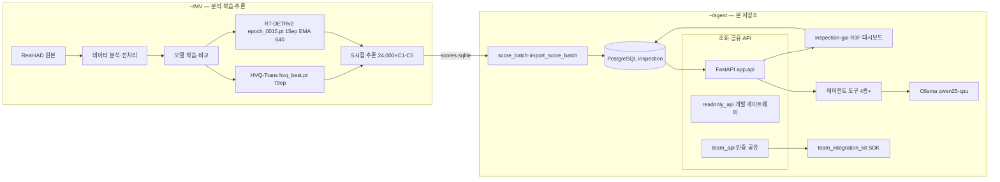
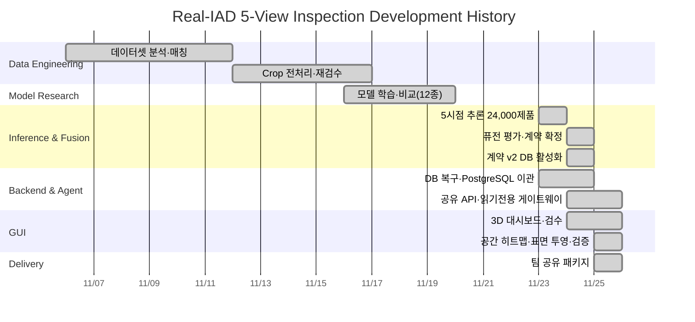

# Real-IAD 5시점 제조 외관검사 AI 시스템 (agent)

Real-IAD 공개 데이터셋을 활용해 **제품 1개를 C1~C5 5개 시점으로 촬영·검사**하는 제조 외관검사 시스템의
백엔드·GUI·공유 SDK 저장소입니다. 데이터 분석·모델 학습·추론·퓨전 평가는 자매 저장소 **~/MV**에서 수행하고,
본 저장소는 데이터베이스·FastAPI·AI 에이전트·3D GUI·공간 히트맵·팀 공유를 담당합니다.

## 1. 프로젝트 소개

### 배경과 문제
- 제조 외관검사는 인간 검사자 육안에 의존해 **피로·주관성·일관성 한계**가 있으며, 결함이 작고 품목마다
  양상이 달라 단일 규칙으로 자동화하기 어렵습니다.
- Real-IAD는 30개 품목의 산업제품을 다시짜임(resolution)별로 촬영한 대규모 이상탐지 데이터셋이며,
  본 프로젝트는 여기서 **제품당 5시점(C1~C5) 묶음**을 하나의 검사 단위로 정의했습니다.
- **단일 시점 검사의 한계**: 한 방향 촬영만으로는 결함이 가려지거나 반대쪽 결함을 볼 수 없습니다.
  5시점을 묶어 제품 단위로 판정하면 시야 사각을 줄이고 제품 수준 Recall을 높일 수 있습니다.

### 이상탐지 + 객체탐지 결합 이유
- **HVQ-Trans(이상탐지)**: 정상만 학습해 화소 단위 이상 점수(heatmap)를 만들어 미등록 결함에도 반응합니다.
- **RT-DETRv2(객체탐지)**: 학습된 결함 클래스를 Bounding Box로 지목해 **위치·근거**를 제공합니다.
- 둘의 점수 척도·성격이 달라 단독 사용보다 **가중 퓨전 + 품목별 정규화**가 유리하다는 것이
  실험으로 확인됐고, 최종 계약(v2)로 확정됐습니다.

### 목표와 최종 구현 범위
- 24,000제품·120,000시점(C1~C5×24,000) 원시 추론(실패 0건) 및 DB 적재
- 퓨전 계약 v2 평가(학습 제외 Test 기준)와 운영 DB 활성화
- FastAPI 도형 API + Ollama 기반 AI 에이전트(도구 호출)
- Vite+React+R3F 3D 대시보드(부위별 히트맵·공간 히트맵·근사 3D 표면 투영·검수 모드)
- 팀원 공용 공유 API + SDK(ZIP)

## 2. 최종 시스템 아키텍처



실제로 연결된 경로만 그렸습니다. 운영 중앙 서버(:8000)는 아직 구 코드라 공유 API(/products·/heatmaps·/fusion/runs)가
미탑재 상태이며, 최신 코드는 개발 게이트웨이(:18080)와 ASGI 테스트로 검증됐습니다.

## 3. 연구 및 개발 과정

| 단계 | 수행 내용 | 주요 결과 |
|---|---|---|
| 데이터셋 구조 분석 | 30품목 이미지·마스크·메타 매칭, 밝기 분포, 해상도 정보 손실 | 제품 ID 충돌 4,197개 발견·해소, 분할 표 복구 |
| 전처리 | 객체 중심 Crop 비교·재검수, 마스크 기반 bbox 추출 | 이상탐지는 승인 Crop, 탐지는 원본 전체 사용 정책 확정 |
| 모델 비교·선정 | 12종 모델 학습/평가 인프라, PatchCore·EfficientAD-S·INP-Former 등 | HVQ-Trans + RT-DETRv2 최종 선정 |
| 5시점 추론 | batch5(C1~C5) 추론·감독·재개 | 24,000제품·120,000시점 실패 0건 |
| 퓨전 규칙 비교 | max16/백분위/RT0.55 vs minmax/heatmap_mean/RT0.4 | **v2가 동일 범위에서 전 지표 상승 → 확정** |
| DB 적재·동기화 | SQLite→PostgreSQL, 읽기전용 역할, 검수 낙관적 잠금 | 운영 DB 구축, reviews 충돌 409 처리 |
| 에이전트 | Ollama qwen25-cpu + 도구 레지스트리 | 수치는 분자/분모·근거 기반 답변 |
| 3D GUI | 30품목 메시, 부위별·공간 히트맵, 검수 모드 | tokens.css 디자인 시스템, vitest 135 |
| 공간 히트맵 | 저장 박스를 ROI 좌표로 정규화해 32² 격자 | 실제 수치 배열 공유(대표 제품) |
| 3D 표면 투영 | 사용자 승인 하에 근사 표면 투영(DataTexture+Shader) | 물리 좌표 실측이 아닌 시각화 근사 |
| 팀 공유 | 공유 API·OpenAPI·SDK ZIP | 649파일, secret scan 통과 |

## 4. 개발 이력 (간트차트)



날짜 근거: MV 산출물 디렉터리명(20261106~20261117)·성능 보고서(20261119~20)·agent_integration_20261123_v1·
final_performance_minmax 타임스탬프(2026-11-24)·FINAL_GUI_VALIDATION/ZIP 생성일(2026-11-25).
파일 수정 시각이 아닌 산출물·보고서 생성 기록 기준입니다.

## 5. 최종 모델 및 성능

### 모델 선정 근거
- HVQ-Trans(hvq_best.pt, 79ep): 정상 기반 이상탐지. 연속 heatmap 평균 점수가 결함 위치와 일치함을 표본 검증.
- RT-DETRv2(epoch_0015.pt, 15ep EMA, 640×640 전처리): 실시간 계열 탐지기로 박스 근거 제공.
- 상호보완: 이상탐지는 미등록 결함에 강하고, 탐지는 위치 근거를 줍니다. 퓨전으로 둘의 강점을 결합.

### 퓨전 계약 v2 (weighted-minmax-heatmap-mean-rt40-v1)
`fusion_score = 0.7×RT_norm + 0.3×HVQ_norm` — RT는 저장 최대 신뢰도 0.4 미만이면 0, HVQ는 연속 heatmap_mean.
정규화는 Validation(3,610제품) 품목별 min/max만 산출해 Test/운영에 고정 적용(외삽 허용, 상수 범위 거부).
제품 점수는 C1~C5 최댓값. 품목별 TH는 Val F1 최적 구간 중점, 보류 margin은 F1 하락 0.005 이내 구간.

### 성능 (저장 점수 재평가, 재추론 없음)

| 범위 | 제품 | Recall | F1 | FP/FN | AUROC | 보류 |
|---|---:|---|---:|---|---|---:|
| **Test(학습·검증 제외)** | 3,593 | 1,752/1,838 = **95.3210%** | **0.953210** | 86/86 | 0.986346 | 37 |
| 전체 참고(Val 포함) | 24,000 | 12,102/12,408 = 97.5338% | 0.968780 | 474/306 | 0.992895 | 194 |

전체 집계는 Validation을 포함하고 원본 train 분할(16,797)과의 실제 학습 중복은 UNKNOWN이므로 **참고 지표**입니다.
**대표 지표는 Test 값**입니다. 과거 보고된 98.84%는 평가 원본이 확인되지 않아 사용하지 않습니다.

### 이전 규칙과의 비교(동일 범위)

| 규칙 | Test F1 | 전체 F1 |
|---|---:|---:|
| 구 max16/백분위/RT0.55 | 0.942795 | 0.959035 |
| **현재 v2** | **0.953210** | **0.968780** |

## 6. 기술적 문제와 해결

| 문제 | 원인 | 해결 | 검증 |
|---|---|---|---|
| 제품 ID 충돌(4,197) | 결함 폴드가 ID에 누락돼 같은 일련번호가 합쳐짐 | 폴드 포함 ID로 전환 | identity audit JSON |
| 마스크-원본 매칭 오류 | 파일명·해상도 불일치 | 매니페스트 기준 매칭 | 칫솔 132·지퍼 98장 재검증 일치 |
| 점수 척도 불일치 | 모델별 점수 범위 상이 | Val 품목별 min-max 정규화 | 24,000제품 전수 감사 오차 0 |
| 평가 분모 혼동 | 전체 24,000 vs Test 3,593 | 두 집계 병행 표기 | 최종 보고서 분리 |
| HVQ 맵 누락 | 상대경로를 cwd 기준 검사 | 점수 캐시 디렉터리 기준 복원 | 실제 500맵/100제품 확인 |
| 부위 단일 색 히트맵 | 부위당 rate 스칼라만 집계 | 저장 박스→ROI 좌표 32² 격자 | 실제 배열·오버레이 육안 확인 |
| 3D UV 반복 | primitive UV가 필라멘트에 반복 | 승인된 근사 표면 투영 | Three 객체·자원 해제 검증(GPU 미검증) |
| 운영 서버 구 코드 | 재시작 승인 경계 | 개발 게이트웨이로 신기능 검증 | :18080 실응답 확인 / **배포는 승인 대기** |

미해결: 운영 :8000 신코드 배포, 물리 UV/칙첩 정합, HVQ 원시 맵 100제품 한정, 실브라우저 스크린샷 촬영.

## 7. GUI 시각 자료

브라우저 스크린샷은 샌드박스 제약으로 미촬영했습니다. 대신 실제 데이터 검증 산출물(소프트웨어 오버레이)을 인용합니다.

- ROI 육안 검증: `reports/part_heatmap/native-roi-review.jpg`, `verify-multi-region.jpg`, `verify-multi-polygon.jpg`
- 5시점 원본: `reports/part_heatmap/toothbrush-five-views.jpg`
- 마스크/모델 격자 비교: `reports/gui_validation/spatial-urgent/mv-mask-native-grid-model-comparison.jpg`
- 지퍼 실제 박스 증거: `reports/gui_validation/spatial-urgent/native-roi-box-proof.png`
- 카테고리 3D 참조: `reports/gui_validation/category_references.jpg`

## 8. 실행 및 재현

```bash
# A. 전체 시스템 개발자(~/agent)
cd ~/agent && uv sync                        # 또는 .venv 재사용
set -a && source .env && set +a              # DATABASE_URL* (실제 자격증명은 .env만)
.venv/bin/python -m pytest -q                # 백엔드 133 passed/4 skipped
.venv/bin/python -m uvicorn app.api:app --host 0.0.0.0 --port 8000      # 운영(신코드)
.venv/bin/python -m uvicorn app.readonly_api:app --port 18080           # 읽기전용 개발
cd inspection-gui && npm ci && npx vitest run && npm run build

# B. 중앙 API만 쓰는 팀원 — team_integration_kit.zip 해제 후 QUICKSTART.md
# C. 3D SDK만 쓰는 팀원 — team_integration_kit/three_surface + THREE_SURFACE_GUIDE.md
# D. 에이전트 개발 팀원 — app/tools.py TOOL_SCHEMAS + GET /tools 스키마
```

운영 서버 재시작·팀 공유 서비스(18081) 기동은 사용자 승인 후 수행합니다(TEAM_SHARING_GUIDE.md).

## 9. 한계 및 향후 개선

- **3D 표면 투영은 근사 시각화**이며 실측 좌표 복원(CAD·칙첩 extrinsics)이 아니다.
- **HVQ 원시 맵은 500시점/100제품**만 저장됐고 나머지는 스칼라 점수뿐이다.
- 전체 24,000 집계는 **학습 중복 가능성(UNKNOWN)**을 가진 참고 지표다.
- Train NG 기반 마스크 위치 분포는 제품별 자세 정합 없는 집계다.
- 미관측 영역·소표본은 수치 대신 사유를 표시한다.
- 향후: 운영 배포, HVQ 맵 확장 추론, 물리 정합, 실환경 운영 검증.

## 10. 저장소 구성

- `app/` FastAPI 백엔드(중앙·읽기전용·공유 API), `agent.py` Ollama 에이전트
- `inspection-gui/` 3D GUI 소스, `tests/` 백엔드 테스트, `scripts/` 운영·평가 스크립트
- `config/` 퓨전·ROI·공간 설정, `team_integration_kit/` 팀 공유 SDK + ZIP
- `reports/` 평가·검증 산출물, `docs/` 상세 문서
- 상세 문서: `docs/ARCHITECTURE.md`, `docs/DEVELOPMENT_HISTORY.md`, `docs/FUSION_EVALUATION.md`,
  `docs/HEATMAP_PIPELINE.md`, `docs/AGENT_DESIGN.md`, `docs/TEAM_INTEGRATION.md`,
  `docs/TROUBLESHOOTING.md`, `docs/REPRODUCIBILITY.md`, `docs/LIMITATIONS.md`
